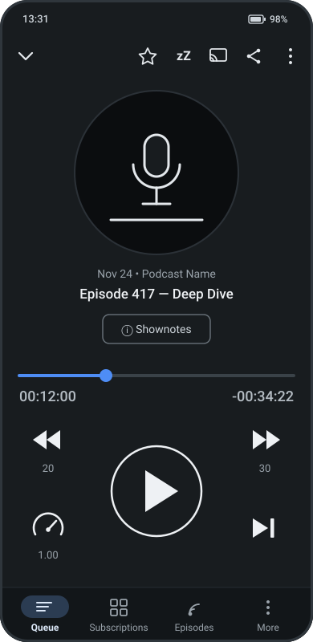

# AntennaPod

This is the official repository of AntennaPod, the easy-to-use, flexible and open-source podcast manager for Android.

     

## Custom Changes in This Fork (`fixes` branch)

All changes below are branched from `master` and merged into `fixes`, sorted by order of importance:

1. **Redesigned Audio Player Screen Layout** (`improve_player`):
   - Enlarged timestamp font size (`18sp`) for better readability.
   - Replaced the cramped single-row controls with a spacious 2-row layout (`36dp` horizontal padding) and an enlarged **`116dp`** centered Play/Pause button: Rewind (top-left), Fast Forward (top-right), Play/Pause (center), Playback Speed (bottom-left), and Skip/Delete (bottom-right).
2. **Short-Press Skip vs. Long-Press Delete & Mark as Played** (`skip_button`):
   - Removed the global *"Keep skipped episodes"* setting.
   - **Short press** on Skip keeps the current episode and jumps to the next one.
   - **Long press** on Skip marks the episode as played, removes it from the queue, deletes its downloaded file, and moves to the next episode (preserving play/pause state: starts playing next only if the player was playing).
3. **One-Tap Play & Auto-Open Full-Screen Player** (`improve_player`):
   - In the **Queue** screen, tapping either the episode row or the right button plays the episode and opens the full-screen player.
   - In **Episodes**, **Inbox**, **Downloads**, and **Playback History**, tapping a **downloaded** episode plays it and opens the full-screen player (undownloaded episodes still open show notes).
   - On **any screen**, tapping a Play action button plays the episode and opens the full-screen player.
4. **Mark Episodes as Played on Every Deletion** (`played_delete`):
   - Every downloaded episode deletion (swipe action, long-press menu, multi-select, delete button, or auto-delete) automatically resets playback position and marks the episode as played to keep episode lists clean.
5. **Fix Background Feed Refresh & Auto-Download Reliability** (`auto_download`):
   - Fixed the inverted sign on `JOB_SCHEDULE_TIME_VARIATION` in `FeedUpdateWorker` so hourly background refreshes no longer skip feeds refreshed 60 minutes earlier.
   - Awaited `AutoDownloadManager.autodownloadUndownloadedItems()` inside `FeedUpdateWorker` before returning `Result.success()` so downloads finish enqueueing before the worker exits.
6. **Keep Currently Playing Episode Pinned at Top of Queue** (`improve_queue`):
   - Sorting the queue or adding new episodes keeps the currently playing episode pinned at position #1.
7. **Ignore Unwanted Bluetooth Auto-Play** (`improve_player`):
   - Ignores `KEYCODE_MEDIA_PLAY` and Bluetooth playback resumption events when AntennaPod is not actively playing.
8. **Minimize App on Back Press from Full-Screen Player** (`improve_player`):
   - Pressing Back while the full-screen player is expanded minimizes the UI (`moveTaskToBack(true)`) while playback continues in the background.
9. **Remove "Clear queue" from Queue Overflow Menu** (`improve_queue`):
   - Removed the "Clear queue" item from the Queue screen's `⋮` menu to prevent accidentally clearing the queue.

### Redesigned Player Screen Mockup

## Feedback
You can use the [AntennaPod Forum](https://forum.antennapod.org/) for discussions about the app or just podcasting in general.

Bug reports and feature requests can be submitted [here](https://github.com/AntennaPod/AntennaPod/issues) (please read the [instructions](https://github.com/AntennaPod/AntennaPod/blob/develop/CONTRIBUTING.md) on how to report a bug and how to submit a feature request first!).

We also hold regular community calls to discuss anything AntennaPod-related. [Come join the next call](https://forum.antennapod.org/t/monthly-community-call/1869)!

## Help to test AntennaPod
AntennaPod has many users and we don't want them to run into trouble when we add a new feature. It's important that we have a significant group test our app, so that we know all possible combinations of phones, Android versions and use cases work as expected. Check out our wiki on how to join our [Beta testing program](https://antennapod.org/documentation/general/beta)! If a bug is reported during the beta period, chances are high that it will be fixed before the upcoming stable version. If it is reported later, fixing might take another full beta cycle. So definitely let us know if something is not right.

## License

AntennaPod is licensed under the GNU General Public License (GPL-3.0). You can find the license text in the [LICENSE](https://github.com/AntennaPod/AntennaPod/blob/develop/LICENSE) file.

## Translating AntennaPod

If you want to translate AntennaPod into another language, you can visit our [Weblate page](https://hosted.weblate.org/projects/antennapod/).

## Building AntennaPod

You can build AntennaPod just like any other Android project. Refer to the [instructions](https://github.com/AntennaPod/AntennaPod/blob/develop/CONTRIBUTING.md) for more details.

